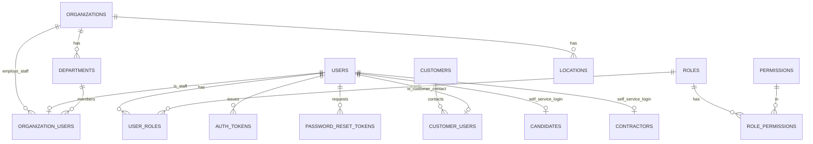
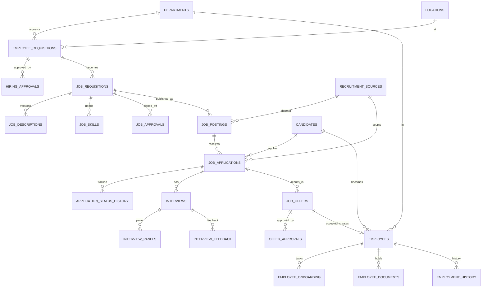
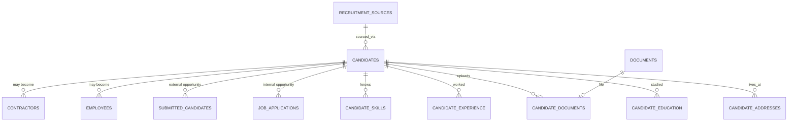
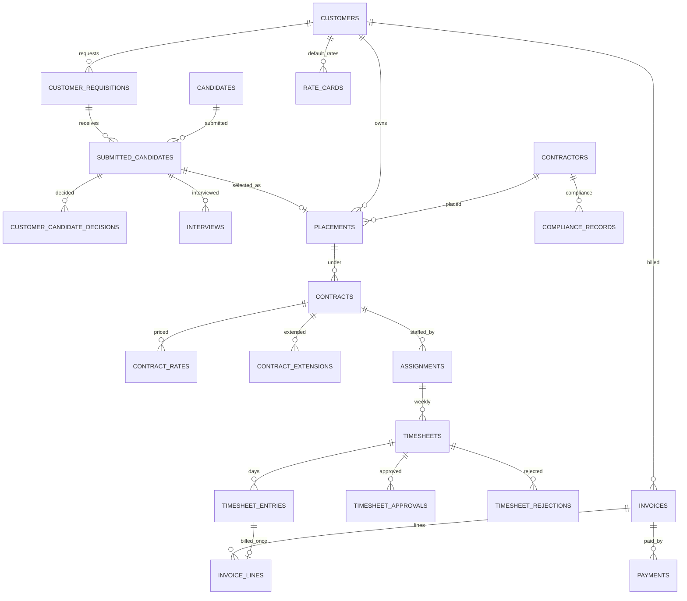
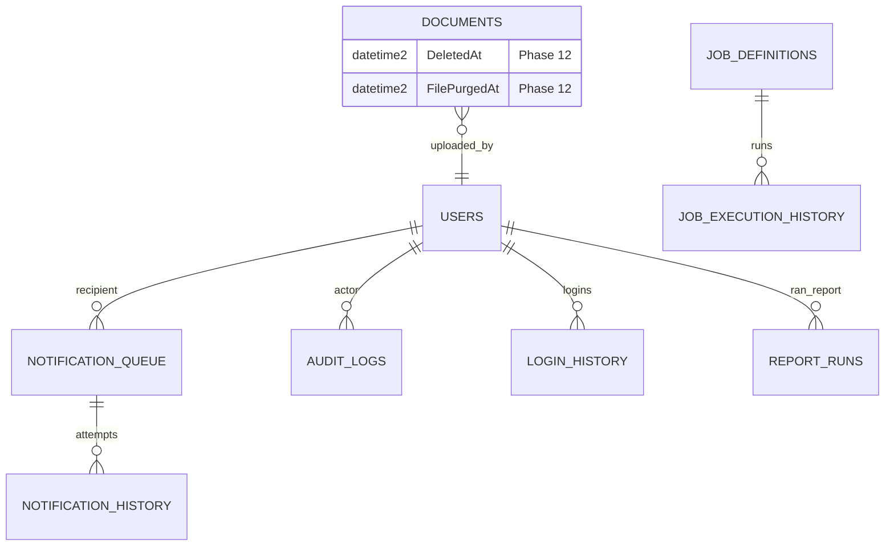

# TAMS — Entity Relationship Diagram (Phase 1 draft for approval)

No tables exist yet. Notation: `||--o{` = one-to-many. Only keys and the main business columns are shown here; the full column list is in `DATABASE_DESIGN.md`.

## 1. Security, organization and the "who is this person" model

## 2. Internal recruitment

## 3. Candidate master (shared by both models)

## 4. External staffing, timesheets and billing

## 5. Supporting tables

## 6. Key relationship decisions

| # | Decision | Where enforced |
|---|---|---|
| R1 | One **Candidate Master** row per person (unique normalized email). Applications (internal) and submissions (external) both point at it, so one candidate can pursue many opportunities with no duplication. | UQ on `Candidates.EmailNormalized` |
| R2 | **Employee** and **Contractor** are separate tables, each referencing `CandidateId`. No shared columns beyond the FK. | FKs, no common supertype |
| R3 | **Pay rate and bill rate** live in separate columns of `ContractRates` with an effective date range; invoices use the *bill* rate snapshotted onto `InvoiceLines`. | CHECK `BillRate >= 0`, `PayRate >= 0`; no-overlap enforced in the proc |
| R4 | **Customer isolation:** `CustomerId` is denormalized onto `CustomerRequisitions`, `SubmittedCandidates`, `Placements`, `Contracts`, `Assignments`, `Timesheets`, `Invoices`, `Payments`. Composite FKs keep parent and child on the same customer. | composite FK `(Id, CustomerId)`, plus proc filters |
| R5 | **Interviews** belong to exactly one opportunity type: either `JobApplicationId` (internal) or `SubmittedCandidateId` (external). | CHECK exactly-one-not-null |
| R6 | **No double billing:** an approved `TimesheetEntry` can appear on at most one `InvoiceLine`. | UQ on `InvoiceLines.TimesheetEntryId` |
| R7 | **Duplicate applications / submissions** are blocked, but a withdrawn one may be re-opened. | filtered unique indexes |
| R8 | **Offer → Employee** is 1:1 and created transactionally on acceptance. | UQ on `Employees.JobOfferId` |
| R9 | **Timesheet** is unique per assignment per week; rejection returns it to Draft for resubmission, with history kept in `TimesheetRejections`. | UQ `(AssignmentId, WeekStartDate)` |
| R10 | `ApplicationStatusHistory`, `AuditLogs`, `TimesheetApprovals/Rejections`, `NotificationHistory` are append-only. | triggers block UPDATE/DELETE |

## 7. Tables beyond the spec's list (justified)

| Table | Reason |
|---|---|
| `sec.AuthTokens` | server-side token revocation (logout) |
| `sec.PasswordResetTokens` | password reset workflow |
| `sec.EmailVerificationTokens` | e-mail confirmation of self-registered accounts (Phase 9; FK UserId → sec.Users; token stored as SHA-256 only) |
| `report.ReportDefinitions` | catalog of the 19 parameterised reports (Phase 10; no foreign keys; roles, filters and chart per report) |
| `sched.JobExecutionDetails` | what one scheduled-job run did (Phase 11; FK ExecutionId → sched.JobExecutionHistory) |
| `org.CustomerUsers` | link a Customer-role login to exactly one customer (isolation) |
| `report.DailyRecruitmentSummary` | output of the daily summary Agent job |

No other additions are planned.
